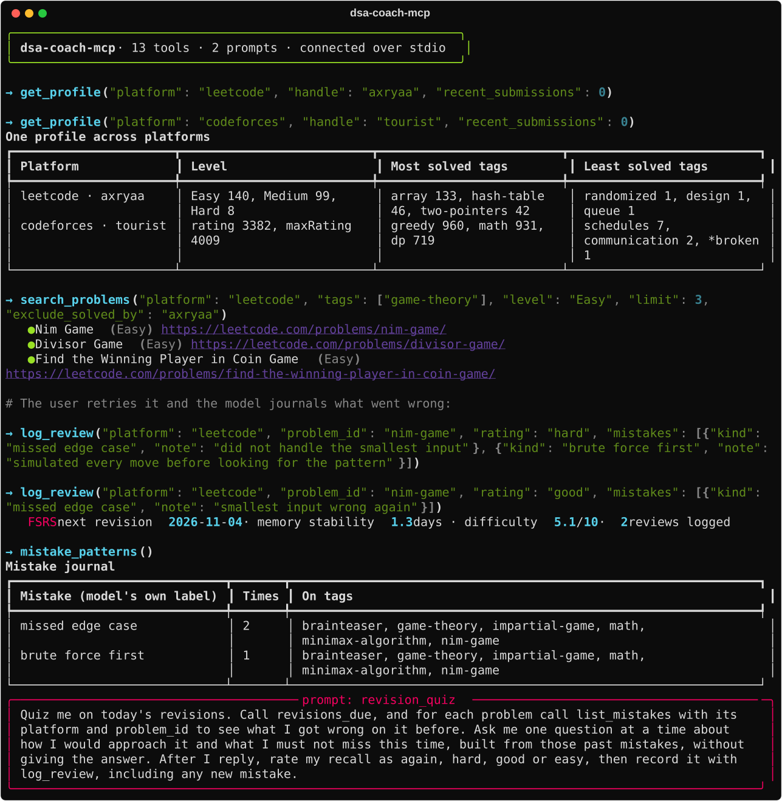
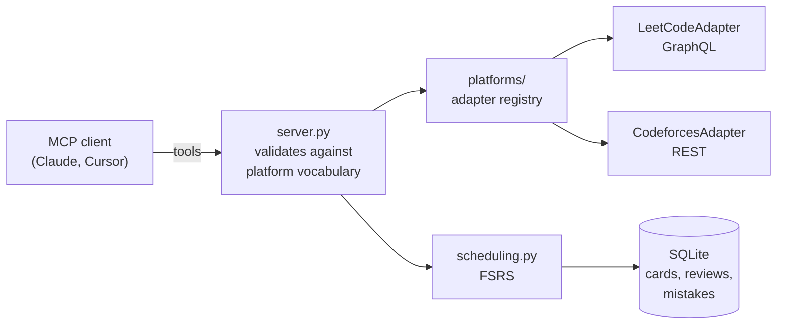
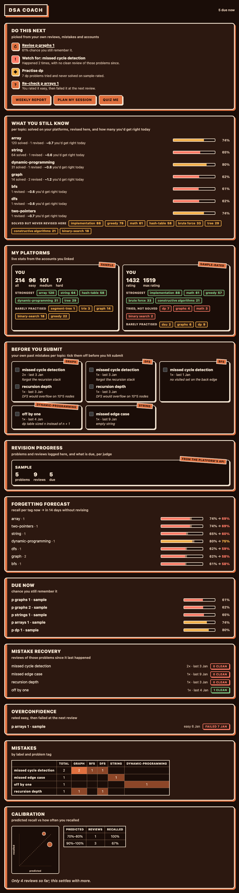
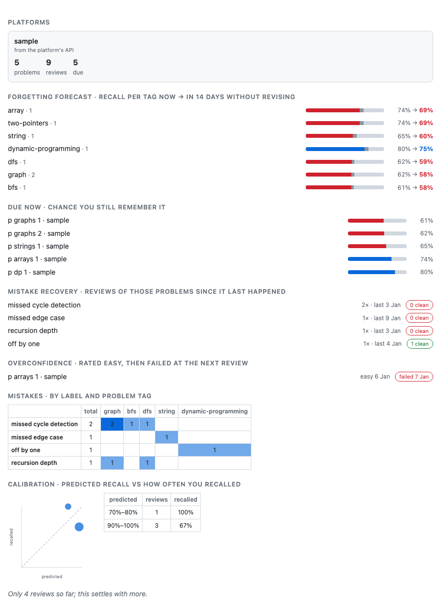

# dsa-coach-mcp

<!-- mcp-name: io.github.aaryagodbole/dsa-coach-mcp -->

[](https://github.com/aaryagodbole/dsa-coach-mcp/actions/workflows/ci.yml)
[](https://pypi.org/project/dsa-coach-mcp/)
[](https://www.python.org/)
[](LICENSE)

An [MCP](https://modelcontextprotocol.io) server that turns your **LeetCode** and
**Codeforces** history into a DSA coach inside Claude, Cursor or any MCP client:
see where you stand across platforms, get problems to try next, and revise what you
solved on a spaced-repetition schedule, with a **mistake journal** that remembers
*why* you got things wrong and builds your next practice set around it.

<p align="center">
  
</p>
<p align="center"><sub>A real session, recorded by <a href="examples/demo.py"><code>examples/demo.py</code></a>: it starts the server over stdio and calls its tools on live data.</sub></p>

## Why

Practice data is split across sites, and each grades difficulty its own way
(LeetCode's Easy/Medium/Hard, Codeforces' 800-3500 ratings). Most trackers count
problems; few tell you what you are forgetting. This server puts both platforms
behind one interface and schedules revision with
[FSRS](https://github.com/open-spaced-repetition/fsrs4anki/wiki/ABC-of-FSRS), so the model
you already talk to can coach you.

FSRS predicts the chance you still remember each problem and brings it back just before
that chance drops below 90%. In the open
[spaced-repetition benchmark](https://github.com/open-spaced-repetition/srs-benchmark)
over ~10k Anki collections, FSRS predicted recall better than SM-2 for the large
majority of users. Once you have a review history, `personalize_schedule` fits its
parameters to how fast **you** forget.

Counting solved problems hides the real signal: the same few mistakes, repeated. Every
review can carry the mistakes behind it, and the model turns those patterns into
practice sets and revision quizzes aimed at exactly what you keep missing.

## Design

The server returns **data, not decisions**. It never hardcodes what counts as a weak
topic or the next level up; the model reads your profile and the platform's own
vocabulary and decides.



- **Adapters** translate one platform's API into shared models (`Problem`, `Profile`,
  `PlatformInfo`). Nothing outside an adapter names a platform.
- **Data comes from the platforms.** Tags and levels are read from each platform's
  API, and a review takes the problem's title, link and tags from the platform rather
  than from the model, so nothing in your history is invented. Platforms' own tag
  lists are incomplete, so `search_problems` accepts a tag outside them and only
  reports it when nothing matched.
- **Profiles say what they can't see.** Each profile carries `limitations`, e.g.
  LeetCode only exposes your 20 most recent accepted submissions publicly.

## Tools

| Tool | What it does |
| --- | --- |
| `list_platforms` | Connected platforms, with the tags and levels each accepts as filters |
| `get_profile` | Your level, solved and unsolved counts per tag, and recent submissions |
| `search_problems` | Problems with every given tag at a given level, optionally skipping ones you solved |
| `log_review` | Records how you did (`again` / `hard` / `good` / `easy`), journals the mistakes behind it, and schedules the next revision with FSRS. Title, link and tags come from the platform |
| `revisions_due` | Problems due now, the one you are least likely to remember first, each with FSRS's recall estimate |
| `schedule_info` | The FSRS parameters in use, whether they are personalised, and how many reviews are logged |
| `personalize_schedule` | Fits FSRS to your own review history (needs `dsa-coach-mcp[optimizer]`) |
| `record_problem` | Records a problem from any other platform (HackerRank, GeeksforGeeks, CodeChef, AtCoder, ...) as read from its page |
| `progress` | Per platform: problems reviewed, reviews logged, and problems due now |
| `show_dashboard` | Progress, revisions due by risk of forgetting, and a mistake heatmap, as an interactive view in hosts that support [MCP Apps](https://modelcontextprotocol.io/docs/extensions/apps) |
| `mistake_kinds` | Every mistake label used so far, so new mistakes reuse the same words |
| `list_mistakes` | Journaled mistakes, filterable by label, tag, platform or recent days |
| `mistake_patterns` | Mistake counts per label, broken down by tag, platform and month |

### Prompts

| Prompt | What it does |
| --- | --- |
| `practice_plan` | Builds the next practice set from your recurring mistakes and progress |
| `revision_quiz` | Quizzes you on today's revisions using what you got wrong before |

### Dashboard

`show_dashboard` shows progress per platform, the revisions due now, and what your own
history says about your memory: a **forgetting forecast** (recall per tag now and in two
weeks if you revise nothing), **mistake recovery** (reviews since each mistake last
happened), **overconfidence** (problems rated easy and failed at the next review) and
**calibration** (FSRS's predicted recall against how often you actually recalled).

It is an [MCP App](https://modelcontextprotocol.io/docs/extensions/apps):
hosts that support them (Claude, Claude Desktop, VS Code Copilot, Goose and others) render
it inside the conversation; every other host gets the same data as the tool's result.
The view is a React app built into one self-contained HTML file with no external scripts, follows the host's
light or dark theme, and talks to the host over the MCP Apps postMessage protocol.

<p align="center">
  
  
</p>
<p align="center"><sub>Rendered from sample data by <a href="examples/dashboard_host.py"><code>examples/dashboard_host.py</code></a>, which plays the host's side of the protocol.</sub></p>

### Any platform

LeetCode and Codeforces have adapters that read from their APIs. Every other platform
works through the page you are looking at: pair this server with a browser MCP server
such as [Playwright MCP](https://github.com/microsoft/playwright-mcp) in extension mode,
which lets the model read the tab open in your own browser, logged in. The model reads
the problem page and calls `record_problem` with its URL, title, tags and difficulty;
from then on it is reviewed, scheduled and journaled like any other problem.

```json
{
  "mcpServers": {
    "dsa-coach": { "command": "uvx", "args": ["dsa-coach-mcp"] },
    "playwright": { "command": "npx", "args": ["@playwright/mcp@latest", "--extension"] }
  }
}
```

No platform is listed in the code: the platform is the problem URL's host, and its
problem id is the URL's path. Problems recorded this way are marked
`"source": "reported"`, because they come from a page the model read rather than from
the platform's API, and a host that has an adapter is always sent to its adapter.

### Mistake journal

There is no fixed list of mistake types. The model labels each mistake in a few words
and is shown every label used before, so it reuses yours instead of inventing new ones;
your journal's vocabulary grows from your own reviews. The server only stores and counts
them; spotting the pattern is the model's job.

```text
You:    Redid Course Schedule. Forgot to detect the cycle again, and used DFS recursion
        that would overflow on 10^5 nodes.
Claude: (log_review rated "hard" with two mistakes, reusing your existing
        "missed cycle detection" label)
        That's the third time cycle detection has slipped on graph problems ...
```

## Install

Requires [uv](https://docs.astral.sh/uv/).

**Claude Desktop**: add to `claude_desktop_config.json`:

```json
{
  "mcpServers": {
    "dsa-coach": {
      "command": "uvx",
      "args": ["dsa-coach-mcp"]
    }
  }
}
```

**Claude Code**:

```bash
claude mcp add dsa-coach -- uvx dsa-coach-mcp
```

**Cursor**: same `command` and `args` as above in `.cursor/mcp.json`.

### Agent skill

[`skills/dsa-coach/SKILL.md`](skills/dsa-coach/SKILL.md) tells the agent when to reach
for these tools and how to use them well: how to rate a review, to reuse existing
mistake labels, and to record problems from other platforms only from a page it read.
For Claude Code, copy it into your skills:

```bash
mkdir -p ~/.claude/skills/dsa-coach
curl -fsSL https://raw.githubusercontent.com/aaryagodbole/dsa-coach-mcp/main/skills/dsa-coach/SKILL.md \
  -o ~/.claude/skills/dsa-coach/SKILL.md
```

### Configuration

| Variable | Default | Purpose |
| --- | --- | --- |
| `DSA_COACH_DB` | `~/.dsa-coach/coach.db` | Where cards, reviews and mistakes are stored |

To personalise the schedule, install the optimizer extra (it pulls in PyTorch):
`uvx --from 'dsa-coach-mcp[optimizer]' dsa-coach-mcp`.

## Privacy

No login and no API keys. The server only calls the platforms' public APIs with the
handles you give it, and revision cards stay in a local SQLite file.

## Adding a platform

1. Write `src/dsa_coach_mcp/platforms/<name>.py` with a class implementing
   [`PlatformAdapter`](src/dsa_coach_mcp/platforms/base.py): `name`, `describe()`,
   `profile()` and `search()`.
2. Add the class to `ADAPTERS` in
   [`platforms/__init__.py`](src/dsa_coach_mcp/platforms/__init__.py).
3. Add tests with a mocked API, like [`tests/test_codeforces.py`](tests/test_codeforces.py).

The server and tools need no changes.

## Evals

Unit tests check the code; [`evals/`](evals/) checks whether a model can actually
coach with these tools. A model drives the real server over the MCP protocol, against a
fixture world (one practice platform, a seeded history, a fixed clock), on tasks such
as planning from a profile, logging a review with its mistakes, reusing an existing
mistake label, recording a problem from another platform, and staying silent when no
tool is needed.

Grading is deterministic, with no LLM judge: each task lists the tool calls it expects
with predicates on their arguments, the tools it must not touch, and a call budget. A run
reports pass rate, tool-selection accuracy, argument accuracy, tool error rate, calls
per task and token usage.

The model is configuration, not code. Any API that speaks the chat completions format
works, whether a hosted free tier, a paid API or a model served on your own machine:

```bash
EVALS_BASE_URL=<api base url> EVALS_MODEL=<model> EVALS_API_KEY=<key, if needed> \
  uv run python -m evals.run
```

The loop talks to models through a small `AgentBackend` interface
([`evals/backends/base.py`](evals/backends/base.py)); an API with a different wire
format is one more backend module. Runs never start on their own: run it locally, or
start the **Agent evals** workflow from the Actions tab after setting the
`EVALS_BASE_URL` and `EVALS_MODEL` repository variables (and an `EVALS_API_KEY` secret
if your API needs one). The graders, the fixture, the loop and the backend are
unit-tested in CI without calling any model.

## Development

```bash
uv sync
uv run pre-commit install
uv run pytest
uv run ruff check . && uv run ruff format --check .
uv run mypy
```

The dashboard is a React + TypeScript app in [`ui/`](https://github.com/aaryagodbole/dsa-coach-mcp/tree/main/ui/),
built with Vite into the single HTML file the package serves. After changing it, rebuild
and commit the output; CI checks they match:

```bash
cd ui && npm ci && npm run build
```

Re-record the demo at the top of this page against live data:

```bash
uv run python examples/demo.py --leetcode <username> --codeforces <handle>
```

Tests never hit the network: adapters are tested against mocked API responses. See
[CONTRIBUTING.md](CONTRIBUTING.md).

## License

[MIT](LICENSE)
