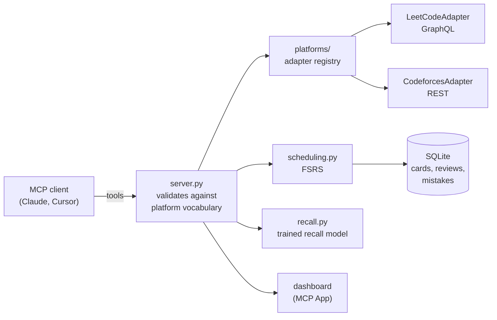

# recall-coach

<!-- mcp-name: io.github.aaryagodbole/recall-coach -->

[](https://github.com/aaryagodbole/recall-coach/actions/workflows/ci.yml)
[](https://pypi.org/project/recall-coach/)
[](https://www.python.org/)
[](https://github.com/aaryagodbole/recall-coach/blob/main/LICENSE)
[](https://aaryagodbole.github.io/recall-coach/)

*Formerly `dsa-coach-mcp`: existing installs, configs and history keep working (see [Configuration](#configuration)).*

**Remember what you solved. Practise what you can just about solve.**

recall-coach is a DSA practice coach for LeetCode, Codeforces and any other judge. It
has three parts:

- **An [MCP](https://modelcontextprotocol.io) server** for Claude, Cursor or any MCP
  client: it reads your history from the platforms, schedules revision, and keeps a
  **mistake journal** of *why* you got things wrong.
- **A dashboard**, inside your AI chat or in the browser: what to revise today, what you
  still know per topic, and your own pre-submit checklist.
- **Models trained on public data** that predict what you are about to forget and what
  you can solve next, evaluated on people and platforms they never saw.

<p align="center">
  
</p>
<p align="center"><sub>A real session, recorded by <a href="https://github.com/aaryagodbole/recall-coach/blob/main/examples/demo.py"><code>examples/demo.py</code></a>: it starts the server over stdio and calls its tools on live data.</sub></p>

## Why

You solve a problem, move on, and three weeks later it is gone. Most trackers count
what you have ever solved; few tell you what you still know, and none tell you which
problem you are about to forget.

recall-coach puts your platforms behind one interface, brings each problem back just
before you are likely to forget it, and builds practice around the mistakes you keep
making. Counting solved problems hides the real signal: the same few mistakes,
repeated. Every review can carry the mistakes behind it, and the assistant turns those
patterns into practice sets and quizzes aimed at exactly what you keep missing.

## Models

Both models are trained and evaluated in [`ml/`](https://github.com/aaryagodbole/recall-coach/tree/main/ml)
on public data, and scored only on data they never trained on. Full method, results
and caveats: [`ml/README.md`](https://github.com/aaryagodbole/recall-coach/blob/main/ml/README.md).

**Recall: will you still remember this problem?** Gradient-boosted trees on a
problem's review history and its [FSRS](https://github.com/open-spaced-repetition/fsrs4anki/wiki/ABC-of-FSRS)
memory state, trained on 7M reviews from 300 users of the
[anki-revlogs-10k](https://huggingface.co/datasets/open-spaced-repetition/anki-revlogs-10k)
dataset. It ranks what to revise.

| On users it never saw | AUC ↑ | Log-loss ↓ |
| --- | --- | --- |
| FSRS, default parameters | 0.789 | 0.365 |
| FSRS, tuned on the user's own first half | 0.840 | 0.327 |
| **recall-coach** (no data from that user) | **0.849** | **0.323** |
| **recall-coach** + a two-number per-user correction | **0.856** | **0.314** |

When it says 70%, about 70% of those problems are remembered: predicted and actual
recall agree within a few points in every band. It ships as 46 KB of plain arrays read
in Python, so the package needs no ML library.

**Solve: will you solve this problem on your first try?** An online Elo model with a
skill per topic, trained on [Project CodeNet](https://github.com/IBM/Project_CodeNet)
(AtCoder, AIZU) and Codeforces, with problem difficulty starting from each judge's own
published rating. Evaluated leaving each judge out entirely, it ranks as well as
LightGBM (AUC 0.70–0.80) and stays calibrated where LightGBM does not. It will power
problem recommendations at a chosen chance of success.

**Limits, measured and stated.** Within one person, every method ranks recall at about
0.70 AUC: forgetting depends on things no log records. The recall model learned from
flashcards, not DSA problems; your own reviews check it, in the dashboard's
calibration panel. LeetCode publishes no failed attempts, so the solve model cannot be
evaluated on LeetCode before use.

## Design

The server returns **data, not decisions**. It never hardcodes what counts as a weak
topic or the next level up; the assistant reads your profile and the platform's own
vocabulary and decides.



- **Adapters** translate one platform's API into shared models (`Problem`, `Profile`,
  `PlatformInfo`). Nothing outside an adapter names a platform.
- **Data comes from the platforms.** Tags and levels are read from each platform's
  API, and a review takes the problem's title, link and tags from the platform rather
  than from the assistant, so nothing in your history is invented. Platforms' own tag
  lists are incomplete, so `search_problems` accepts a tag outside them and only
  reports it when nothing matched.
- **Profiles say what they can't see.** Each profile carries `limitations`, e.g.
  LeetCode only exposes your 20 most recent accepted submissions publicly.
- **FSRS still schedules** each revision's next date, and `personalize_schedule` fits
  its parameters to how fast **you** forget once you have a review history; the recall
  model decides which due problem comes first.

## Tools

| Tool | What it does |
| --- | --- |
| `list_platforms` | Connected platforms, with the tags and levels each accepts as filters |
| `get_profile` | Your level, solved and unsolved counts per tag, and recent submissions |
| `link_account` / `unlink_account` | Saves (or forgets) your username on a platform (or reads it from a pasted profile link), so tools default to it and the dashboard shows that account |
| `import_solved` | Starts tracking the problems you already solved on a platform, most recent first, with each first accepted submission as its first review (good on the first try, hard after rejected tries), so you don't log them one by one. Problems already tracked are left alone |
| `search_problems` | Problems with every given tag at a given level, optionally skipping ones you solved |
| `log_review` | Records how you did (`again` / `hard` / `good` / `easy`), journals the mistakes behind it, and schedules the next revision with FSRS. Title, link and tags come from the platform |
| `review_evidence` | Suggests a `log_review` rating from your actual submissions since the last review: `again` if none was accepted, `good` on a first-try accept, `hard` after rejected tries. Never `easy`, and nothing where a platform hides rejected submissions |
| `revisions_due` | Problems due now, the one you are least likely to remember first, by a trained recall model (and FSRS's own estimate) |
| `schedule_info` | The FSRS parameters in use, whether they are personalised, and how many reviews are logged |
| `personalize_schedule` | Fits FSRS to your own review history (needs `recall-coach[optimizer]`) |
| `record_problem` | Records a problem from any other platform (HackerRank, GeeksforGeeks, CodeChef, AtCoder, ...) as read from its page |
| `progress` | Per platform: problems reviewed, reviews logged, and problems due now |
| `show_dashboard` | Today's five revisions most at risk of forgetting (and how many more are due), progress, a mistake heatmap, a forgetting forecast, mistake recovery, overconfidence and calibration, as an interactive view in hosts that support [MCP Apps](https://modelcontextprotocol.io/docs/extensions/apps) |
| `mistake_kinds` | Every mistake label used so far, so new mistakes reuse the same words |
| `rename_mistake_kind` | Fixes a mistake label everywhere it was used, or merges two labels that mean the same thing |
| `list_mistakes` | Journaled mistakes, filterable by label, tag, platform or recent days |
| `mistake_patterns` | Mistake counts per label, broken down by tag, platform and month |

### Prompts

| Prompt | What it does |
| --- | --- |
| `practice_plan` | Builds the next practice set from your recurring mistakes and progress |
| `revision_quiz` | Quizzes you on today's revisions using what you got wrong before |
| `weekly_report` | Reports on your last week: what you did, what's slipping, mistakes that keep coming back, and three things to do next |
| `hack_my_code` | Paste an accepted solution; it is attacked with tests aimed at your own past mistakes, then the usual edge cases |
| `teach_back` | You teach a confused junior whose wrong code repeats your most common mistake: find the bug and explain it |
| `pattern_drill` | Mixed-topic problems with the tags hidden: name the pattern and the clue before solving |
| `prep_path` | A day-by-day plan for the days left before an interview or contest, from your weak topics, due revisions and repeated mistakes |

### Dashboard

`show_dashboard` has three tabs:

- **Today**: **Do this next**, up to four steps picked from your own data by fixed rules
  (the revision you're most likely to forget, a mistake that keeps coming back, a weak
  topic, a problem you were overconfident about), with **Weekly report**, **Plan my
  session** and **Quiz me** buttons that ask your assistant in the chat; your five
  revisions most at risk, ranked by the recall model, with how many more are due; and
  **Before you submit**, a checklist per topic from your own mistake journal.
- **Skills**: **What you still know**, what you solved per topic against how many of
  those you'd still get right today; **My platforms**, live stats for each linked
  account (paste your profile link to link one); and revision progress per platform.
- **Insights**: what your own history says about your memory: a **forgetting
  forecast** per topic, **mistake recovery**, **overconfidence** (problems rated easy
  then failed) and **calibration** (predicted recall against how often you actually
  recalled).

It is an [MCP App](https://modelcontextprotocol.io/docs/extensions/apps):
hosts that support them (Claude, Claude Desktop, VS Code Copilot, Goose and others) render
it inside the conversation; every other host gets the same data as the tool's result.
In a client that can't render MCP Apps, such as Claude Code, open it in your browser
instead, from the same local history:

```bash
uvx recall-coach dashboard
```

It serves the page on localhost only and stops with Ctrl+C.
The view is a React app built into one self-contained HTML file with no external scripts, follows the host's
light or dark theme, and talks to the host over the MCP Apps postMessage protocol.

<p align="center">
  
  
</p>
<p align="center"><sub>Rendered from sample data by <a href="https://github.com/aaryagodbole/recall-coach/blob/main/examples/dashboard_host.py"><code>examples/dashboard_host.py</code></a>, which plays the host's side of the protocol. <a href="https://aaryagodbole.github.io/recall-coach/">Try the live demo</a>.</sub></p>

### Any platform

LeetCode and Codeforces have adapters that read from their APIs. Every other platform
works through the page you are looking at: pair this server with a browser MCP server
such as [Playwright MCP](https://github.com/microsoft/playwright-mcp) in extension mode,
which lets the model read the tab open in your own browser, logged in. The model reads
the problem page and calls `record_problem` with its URL, title, tags and difficulty;
from then on it is reviewed, scheduled and journaled like any other problem.

```json
{
  "mcpServers": {
    "recall-coach": { "command": "uvx", "args": ["recall-coach"] },
    "playwright": { "command": "npx", "args": ["@playwright/mcp@latest", "--extension"] }
  }
}
```

No platform is listed in the code: the platform is the problem URL's host, and its
problem id is the URL's path. Problems recorded this way are marked
`"source": "reported"`, because they come from a page the model read rather than from
the platform's API, and a host that has an adapter is always sent to its adapter.

### Mistake journal

There is no fixed list of mistake types. The model labels each mistake in a few words
and is shown every label used before, so it reuses yours instead of inventing new ones;
your journal's vocabulary grows from your own reviews. The server only stores and counts
them; spotting the pattern is the model's job.

```text
You:    Redid Course Schedule. Forgot to detect the cycle again, and used DFS recursion
        that would overflow on 10^5 nodes.
Claude: (log_review rated "hard" with two mistakes, reusing your existing
        "missed cycle detection" label)
        That's the third time cycle detection has slipped on graph problems ...
```

## Install

Requires [uv](https://docs.astral.sh/uv/).

**Claude Desktop**: add to `claude_desktop_config.json`:

```json
{
  "mcpServers": {
    "recall-coach": {
      "command": "uvx",
      "args": ["recall-coach"]
    }
  }
}
```

**Claude Code**:

```bash
claude mcp add recall-coach -- uvx recall-coach
```

**Cursor**: same `command` and `args` as above in `.cursor/mcp.json`.

### Agent skill

[`skills/recall-coach/SKILL.md`](https://github.com/aaryagodbole/recall-coach/blob/main/skills/recall-coach/SKILL.md) tells the agent when to reach
for these tools and how to use them well: how to rate a review, to reuse existing
mistake labels, and to record problems from other platforms only from a page it read.
For Claude Code, copy it into your skills:

```bash
mkdir -p ~/.claude/skills/recall-coach
curl -fsSL https://raw.githubusercontent.com/aaryagodbole/recall-coach/main/skills/recall-coach/SKILL.md \
  -o ~/.claude/skills/recall-coach/SKILL.md
```

### Configuration

| Variable | Default | Purpose |
| --- | --- | --- |
| `RECALL_COACH_DB` | `~/.recall-coach/coach.db` | Where cards, reviews and mistakes are stored. An existing `~/.dsa-coach/coach.db` (or `DSA_COACH_DB`) from before the rename keeps being used |

To personalise the schedule, install the optimizer extra (it pulls in PyTorch):
`uvx --from 'recall-coach[optimizer]' recall-coach`.

## Privacy

No login and no API keys. The server only calls the platforms' public APIs with the
handles you give it, and revision cards stay in a local SQLite file.

## Adding a platform

1. Write `src/recall_coach/platforms/<name>.py` with a class implementing
   [`PlatformAdapter`](https://github.com/aaryagodbole/recall-coach/blob/main/src/recall_coach/platforms/base.py): `name`, `describe()`,
   `profile()` and `search()`.
2. Add the class to `ADAPTERS` in
   [`platforms/__init__.py`](https://github.com/aaryagodbole/recall-coach/blob/main/src/recall_coach/platforms/__init__.py).
3. Add tests with a mocked API, like [`tests/test_codeforces.py`](https://github.com/aaryagodbole/recall-coach/blob/main/tests/test_codeforces.py).

The server and tools need no changes.

## Evals

Unit tests check the code; [`evals/`](https://github.com/aaryagodbole/recall-coach/tree/main/evals/) checks whether a model can actually
coach with these tools. A model drives the real server over the MCP protocol, against a
fixture world (one practice platform, a seeded history, a fixed clock), on tasks such
as planning from a profile, logging a review with its mistakes, reusing an existing
mistake label, recording a problem from another platform, and staying silent when no
tool is needed.

Grading is deterministic, with no LLM judge: each task lists the tool calls it expects
with predicates on their arguments, the tools it must not touch, and a call budget. A run
reports pass rate, tool-selection accuracy, argument accuracy, tool error rate, calls
per task and token usage.

The model is configuration, not code. Any API that speaks the chat completions format
works, whether a hosted free tier, a paid API or a model served on your own machine:

```bash
EVALS_BASE_URL=<api base url> EVALS_MODEL=<model> EVALS_API_KEY=<key, if needed> \
  uv run python -m evals.run
```

The loop talks to models through a small `AgentBackend` interface
([`evals/backends/base.py`](https://github.com/aaryagodbole/recall-coach/blob/main/evals/backends/base.py)); an API with a different wire
format is one more backend module. Runs never start on their own: run it locally, or
start the **Agent evals** workflow from the Actions tab after setting the
`EVALS_BASE_URL` and `EVALS_MODEL` repository variables (and an `EVALS_API_KEY` secret
if your API needs one). The graders, the fixture, the loop and the backend are
unit-tested in CI without calling any model.

## Development

```bash
uv sync
uv run pre-commit install
uv run pytest
uv run ruff check . && uv run ruff format --check .
uv run mypy
```

The dashboard is a React + TypeScript app in [`ui/`](https://github.com/aaryagodbole/recall-coach/tree/main/ui/),
built with Vite into the single HTML file the package serves. After changing it, rebuild
and commit the output; CI checks they match:

```bash
cd ui && npm ci && npm run build
```

Re-record the demo at the top of this page against live data:

```bash
uv run python examples/demo.py --leetcode <username> --codeforces <handle>
```

Tests never hit the network: adapters are tested against mocked API responses. See
[CONTRIBUTING.md](https://github.com/aaryagodbole/recall-coach/blob/main/CONTRIBUTING.md).

## License

[MIT](https://github.com/aaryagodbole/recall-coach/blob/main/LICENSE)
