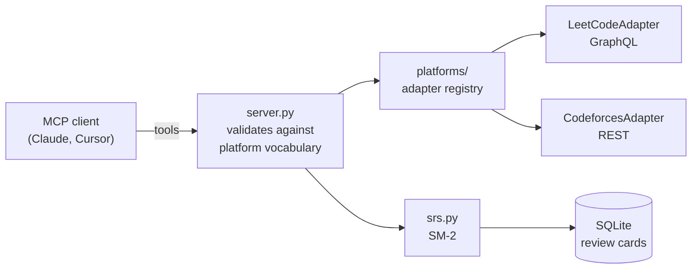

# dsa-coach-mcp

[](https://github.com/aaryagodbole/dsa-coach-mcp/actions/workflows/ci.yml)
[](https://www.python.org/)
[](LICENSE)

An [MCP](https://modelcontextprotocol.io) server that turns your **LeetCode** and
**Codeforces** history into a DSA coach inside Claude, Cursor or any MCP client:
see where you stand across platforms, get problems to try next, and revise what you
solved on a spaced-repetition schedule, with a **mistake journal** that remembers
*why* you got things wrong and builds your next practice set around it.

```text
You:    What should I practise this week? I'm alice on LeetCode and bob on Codeforces.
Claude: (get_profile x2, search_problems)
        Your graph work is thin on both sites: 1 LeetCode graph problem, and 3
        Codeforces graph problems attempted but never accepted. Here are four
        Medium / 1400-rated graph problems you haven't solved yet ...
```

## Why

Practice data is split across sites, and each grades difficulty its own way
(LeetCode's Easy/Medium/Hard, Codeforces' 800-3500 ratings). Most trackers count
problems; few tell you what you are forgetting. This server puts both platforms
behind one interface and adds [SM-2](https://super-memory.com/english/ol/sm2.htm)
revision scheduling, so the model you already talk to can coach you.

Counting solved problems hides the real signal: the same few mistakes, repeated. Every
review can carry the mistakes behind it, and the model turns those patterns into
practice sets and revision quizzes aimed at exactly what you keep missing.

## Design

The server returns **data, not decisions**. It never hardcodes what counts as a weak
topic or the next level up; the model reads your profile and the platform's own
vocabulary and decides.



- **Adapters** translate one platform's API into shared models (`Problem`, `Profile`,
  `PlatformInfo`). Nothing outside an adapter names a platform.
- **Filter values come from the platforms.** Tags and levels are read from each
  platform's API, and `search_problems` rejects anything outside them, so the
  model can't invent a tag.
- **Profiles say what they can't see.** Each profile carries `limitations`, e.g.
  LeetCode only exposes your 20 most recent accepted submissions publicly.

## Tools

| Tool | What it does |
| --- | --- |
| `list_platforms` | Connected platforms, with the tags and levels each accepts as filters |
| `get_profile` | Your level, solved and unsolved counts per tag, and recent submissions |
| `search_problems` | Problems with every given tag at a given level, optionally skipping ones you solved |
| `log_review` | Records how well you recalled a problem (0-5) and schedules the next revision |
| `revisions_due` | Problems due for revision today or overdue |
| `mistake_kinds` | Every mistake label used so far, so new mistakes reuse the same words |
| `list_mistakes` | Journaled mistakes, filterable by label, tag, platform or recent days |
| `mistake_patterns` | Mistake counts per label, broken down by tag, platform and month |

### Prompts

| Prompt | What it does |
| --- | --- |
| `practice_plan` | Builds the next practice set from your recurring mistakes and progress |
| `revision_quiz` | Quizzes you on today's revisions using what you got wrong before |

### Mistake journal

There is no fixed list of mistake types. The model labels each mistake in a few words
and is shown every label used before, so it reuses yours instead of inventing new ones;
your journal's vocabulary grows from your own reviews. The server only stores and counts
them; spotting the pattern is the model's job.

```text
You:    Redid Course Schedule. Forgot to detect the cycle again, and used DFS recursion
        that would overflow on 10^5 nodes.
Claude: (log_review with quality 2 and two mistakes, reusing your existing
        "missed cycle detection" label)
        That's the third time cycle detection has slipped on graph problems ...
```

## Install

Requires [uv](https://docs.astral.sh/uv/).

**Claude Desktop**: add to `claude_desktop_config.json`:

```json
{
  "mcpServers": {
    "dsa-coach": {
      "command": "uvx",
      "args": ["--from", "git+https://github.com/aaryagodbole/dsa-coach-mcp", "dsa-coach-mcp"]
    }
  }
}
```

**Claude Code**:

```bash
claude mcp add dsa-coach -- uvx --from git+https://github.com/aaryagodbole/dsa-coach-mcp dsa-coach-mcp
```

**Cursor**: same `command` and `args` as above in `.cursor/mcp.json`.

### Configuration

| Variable | Default | Purpose |
| --- | --- | --- |
| `DSA_COACH_DB` | `~/.dsa-coach/coach.db` | Where revision cards are stored |

## Privacy

No login and no API keys. The server only calls the platforms' public APIs with the
handles you give it, and revision cards stay in a local SQLite file.

## Adding a platform

1. Write `src/dsa_coach_mcp/platforms/<name>.py` with a class implementing
   [`PlatformAdapter`](src/dsa_coach_mcp/platforms/base.py): `name`, `describe()`,
   `profile()` and `search()`.
2. Add the class to `ADAPTERS` in
   [`platforms/__init__.py`](src/dsa_coach_mcp/platforms/__init__.py).
3. Add tests with a mocked API, like [`tests/test_codeforces.py`](tests/test_codeforces.py).

The server and tools need no changes.

## Development

```bash
uv sync
uv run pre-commit install
uv run pytest
uv run ruff check . && uv run ruff format --check .
uv run mypy
```

Tests never hit the network: adapters are tested against mocked API responses. See
[CONTRIBUTING.md](CONTRIBUTING.md).

## License

[MIT](LICENSE)
